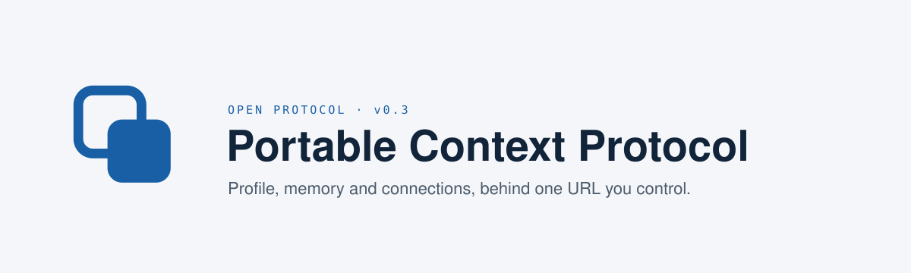

<div align="center" markdown="1">



<p>
  
  
  
  
</p>

# Portable Context Protocol

**An open protocol for AI context you own.**

Your profile, your memory, your connections, behind one URL you control,<br>usable by any AI assistant, on any device, from any vendor.

</div>

PCP is open and independent. It belongs to no company or product. Anyone can implement it, free, for any purpose, without asking. Changes are proposed and decided in public; see [`GOVERNANCE.md`](GOVERNANCE.md).

---

## The problem

Every AI assistant is building a memory of you. Each one keeps it in its own silo. What Claude knows about you, ChatGPT doesn't. What your coding agent learned last week, your phone's assistant has never seen. And when you leave a provider, your context stays behind.

Email solved this decades ago: open protocols meant you could pick any client and any server, and move between them. **PCP does the same for AI context.**

## What PCP is

PCP is a small, open specification built entirely on standards you already use: [MCP](https://modelcontextprotocol.io), OAuth 2.1 and plain Markdown. It defines two things:

1. **A format** for a context: a structured **profile**, long-term **memory** as Markdown pages with YAML frontmatter, and **connections** to live sources like email, notes and tasks.
2. **A server behavior**: a single MCP endpoint that serves that context with per-category consent, a user-visible audit log, and full export.

A context can belong to one person (`personal`), to one person's working life (`work`), or to a team of people and agents (`team`).

## How it works

> Open any MCP-enabled assistant. Paste your context URL. Choose what to share on one consent screen. The assistant now knows your preferences and history, and you can revoke it, audit it, or take it elsewhere at any time.

A PCP server announces itself at a well-known URL:

```http
GET /.well-known/pcp.json
```

```json
{
  "pcp_version": "0.3",
  "kind": "personal",
  "mcp_endpoint": "https://ctx.example.com/mcp",
  "profile_extensions": ["pcp.health"],
  "connections": ["notes"],
  "export": true,
  "encryption": { "key_custody": "user", "readable_by": ["principals", "host_in_request"] }
}
```

Any MCP client can then use the standard tools (`context_brief`, `profile_get`, `memory_search`, `memory_write` and more), limited to the scopes you granted. A coding assistant gets `memory:read`; it never sees `profile.health` unless you say so.

## Principles

- **You own your context.** Full export and import are required for conformance. A server that can't hand your data back isn't a PCP server.
- **Consent by category, not all-or-nothing.** Health, legal, family and financial data live in separate namespaces with their own OAuth scopes.
- **One URL, any client.** If it speaks MCP, it can use your context. No SDK, no new transport.
- **Run it anywhere.** Your laptop, a Raspberry Pi next to a local LLM, a home server, a hosting provider. The wire format is identical, so switching hosts is export + import.
- **Honest claims.** Terms like "encrypted" and "exportable" are defined by the spec and checkable, not marketing.
- **Vendor-neutral by design.** Nothing in the spec may require a specific cloud, database, model provider or company. No implementation is privileged.

## Status

**v0.3, request for comments.** v0.3 is the first version independent implementations can build against and test each other with: a team context model, export and import with a checkable archive, authorization for current MCP, defined key custody, and a [conformance suite](conformance/). PCP is pre-1.0, so a later v0.x may still change things, with migration notes. For the previous text, pin the [`v0.2-draft`](https://github.com/pcp-protocol/pcp/tree/v0.2-draft) tag.

This is the right time to shape the protocol. Early feedback changes the spec; later feedback changes v2.

## Get involved

- **Read the spec**: [`SPEC.md`](SPEC.md). Section 11 lists open questions.
- **Open an issue**: design questions, gaps, things that don't fit your use case.
- **Build an implementation**: a server, a client, an importer, a conformance test. Running code carries the most weight. Open an issue so we can test interop together.
- **Host it**: if you run a hosting platform, PCP is designed to be offered alongside email, storage and websites: one context per customer, standard export, no lock-in. We want to hear what you need from the spec.
- **Write an extension**: new profile namespaces and connections: see [`extensions/`](https://github.com/pcp-protocol/pcp/tree/main/extensions).
- **Harden it**: [`SECURITY.md`](SECURITY.md) is meant to be community-owned. Field reports from self-hosters are especially welcome.

See [`CONTRIBUTING.md`](https://github.com/pcp-protocol/pcp/blob/main/CONTRIBUTING.md) for how to help and [`GOVERNANCE.md`](GOVERNANCE.md) for how changes are decided. Everyone taking part follows the [code of conduct](https://github.com/pcp-protocol/pcp/blob/main/CODE_OF_CONDUCT.md).

## Implementations

Anyone can build a PCP server or client. Listing is open to every implementation, open source or commercial, self-hosted or hosted, and is never an endorsement. Building one? Open a PR to add it.

No implementation claims v0.3 conformance yet. The [conformance suite](https://github.com/pcp-protocol/pcp/tree/main/conformance) checks a server against every requirement in [`docs/conformance.md`](docs/conformance.md), and SPEC §10 says how to claim a profile.

| Project | Role | License | Status |
|---|---|---|---|
| [TomaTío](https://tomatio.ai) | **Reference implementation.** A WordPress plugin that gives teams of people and AI agents a shared memory; serves `team` contexts, with PCP export and import | Open source (GPL) | Implements v0.3 `team` contexts; conformance not yet claimed |
| [Refugio](https://github.com/Phantazein-apps/refugio) | Local LLM; connects to any PCP context as an MCP client, and can host one on `localhost` | Open source, free | PCP client; local server planned |

The reference implementation is the one maintainers test the spec against first. It is an implementation like any other: it does not own PCP, has no special standing in decisions, and nothing in the spec depends on it.

### Fully local: PCP + Refugio

PCP is the *context* refuge; [Refugio](https://github.com/Phantazein-apps/refugio) is the *compute* refuge: a local LLM that never sends data to the cloud. Together they make a fully sovereign setup:

- Refugio connects to your PCP endpoint as a standard MCP client, so your local model gets the same memory and profile as Claude on your phone.
- A PCP server can run on the same machine (`localhost` deployment profile), so nothing leaves your device.
- Refugio's memory backends (MemPalace, PACK) use the format PCP standardizes, so a Refugio install can become a full PCP context without migrating data.

## Repository layout

| Path | Contents |
|---|---|
| [`SPEC.md`](SPEC.md) | The protocol specification |
| [`schemas/0.3/`](https://github.com/pcp-protocol/pcp/tree/main/schemas/0.3) | JSON Schemas: discovery, profiles, memory page frontmatter, tools, audit entries |
| [`examples/0.3/`](https://github.com/pcp-protocol/pcp/tree/main/examples/0.3) | Examples that validate against the schemas (`invalid/` ones must fail) |
| [`scripts/validate_schemas.py`](https://github.com/pcp-protocol/pcp/blob/main/scripts/validate_schemas.py) | Checks every schema, example and example archive (`pip install jsonschema pyyaml`) |
| [`conformance/`](https://github.com/pcp-protocol/pcp/tree/main/conformance) | The conformance suite, its reference server, and the archive checker |
| [`extensions/`](https://github.com/pcp-protocol/pcp/tree/main/extensions) | Extension namespace registry and authoring guide |
| [`docs/`](https://github.com/pcp-protocol/pcp/tree/main/docs) | The conformance requirements, and informative guides: interop with other memory formats, management API, networking, profile bootstrap, style profiles |
| [`SECURITY.md`](SECURITY.md) | Threat model and best practices for self-hosters and hosts |
| [`CONTRIBUTING.md`](https://github.com/pcp-protocol/pcp/blob/main/CONTRIBUTING.md) | How to help |
| [`GOVERNANCE.md`](GOVERNANCE.md) | How spec changes are proposed and decided |
| [`CODE_OF_CONDUCT.md`](https://github.com/pcp-protocol/pcp/blob/main/CODE_OF_CONDUCT.md) | How we treat each other |

## License

Specification text, schemas and examples are licensed under [Apache 2.0](https://github.com/pcp-protocol/pcp/blob/main/LICENSE). Anyone may implement PCP, free of charge, for any purpose. Any implementation that passes the conformance requirements may say it implements PCP; no one may imply the project endorses their product.

## Governance

PCP is developed in the open by its contributors, in the [`pcp-protocol`](https://github.com/pcp-protocol) organization. Decisions are made in public issues and pull requests, on technical merit. No company or implementation has special standing, and none is the "official" one. [`GOVERNANCE.md`](GOVERNANCE.md) has the details.
